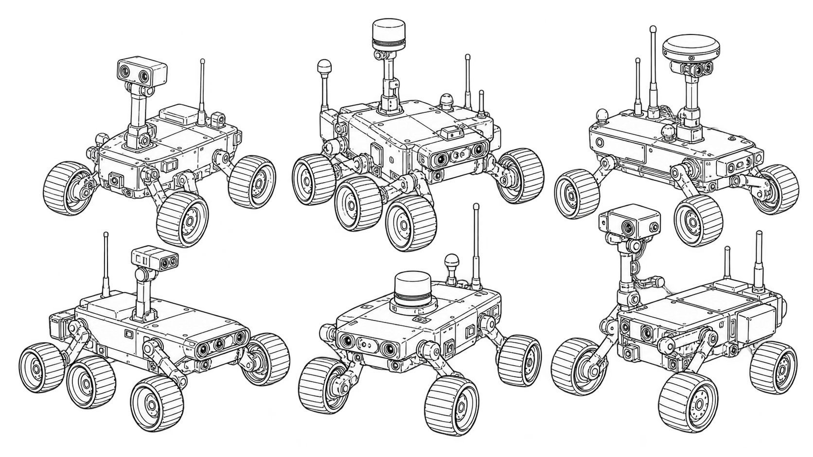
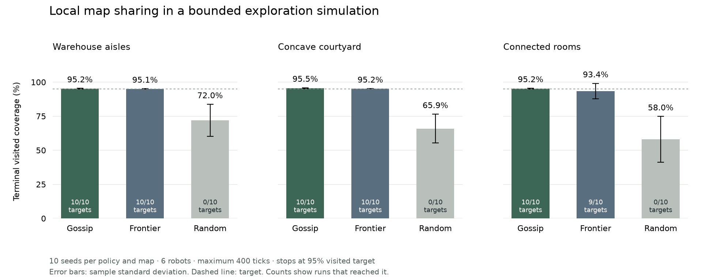

# Swarm Intelligence & Distributed Robotics



*Generated line-art concept illustration.*

**Swarm Field Lab** is a working, dependency-free exploration simulator. Each robot plans from its own map. Nearby robots can exchange observations and visited-cell information. A browser lab replays actual runs, and a CLI reproduces the same results.

This is a new simulation project built on 27 October 2026. It does not establish a physical robot build, a field deployment, or a fully decentralized collision controller.

## Run the lab

Requires Node.js 22 or newer. No model, account, paid API, ROS, or Gazebo installation is needed.

```sh
git clone https://github.com/ungaaaabungaaa/swarm-intelligence-distributed-robotics.git
cd swarm-intelligence-distributed-robotics
npm ci
npm start
```

Open <http://127.0.0.1:8796>. The server binds only to IPv4 loopback. Choose an environment, policy, seed, and robot count. Run the simulation, then play, pause, step, or scrub the replay. A worker runs the bounded simulation without blocking the interface. The position table provides a text alternative to the map. The JSON download contains the real configuration, positions, observation deltas and metrics.

The lab has no accounts, telemetry, local journal, external scripts, or data upload. The source link opens GitHub only if you select it.

## Reproduce a run

```sh
node src/cli.mjs run --scenario rooms --policy gossip --seed 42 --robots 6 --ticks 400 --json
node src/cli.mjs run --scenario warehouse --policy gossip --seed 42 --out new-replay.json
node src/cli.mjs --help
```

`--out` refuses to overwrite an existing file. [`examples/warehouse-replay.json`](examples/warehouse-replay.json) is an actual captured run, not illustrative telemetry. Supported scenarios are `warehouse`, `concave`, and `rooms`; policies are `gossip`, `frontier`, and `random`. Use the help output for sensor, communication, radius, target, and time-step settings.

## How the model works

- Each robot has private occupancy and visited-cell maps. Perfect grid-ray sensing reveals cells up to its sensor radius and stops at obstacles.
- The frontier policy uses BFS through known free cells, keeps a selected goal stable, and chooses a frontier or an unvisited cell. Both frontier policies observe nearby robot positions and use the same local blocked-motion recovery.
- Gossip shares previous-step snapshots only between robots within communication range and grid line of sight. Local target reservations and penalties reduce duplicated work. Information can propagate across several ticks; there is no global shared planning map.
- A **centralized simulation safety shield** checks whole paths against inflated obstacle squares and exact continuous relative disc motion. Rotating priority holds conflicting moves. This central layer is part of the simulator, not a decentralized physical controller.
- The independent-frontier baseline uses the same planner without map/visited sharing or peer target coordination. The random-walk baseline uses the same sensor, starts, tick limit and safety layer.

The ideas are informed by [Yamauchi's multi-robot frontier exploration](https://doi.org/10.1145/280765.280773) and the general local-agent approach in [Reynolds' distributed behavioral model](https://www.red3d.com/cwr/papers/1987/boids.html). The implementation is original and is not a reproduction of either paper's complete method. No source figures or paper text are redistributed. See [methods and assumptions](docs/methods.md) and the [input/output contract](docs/contract.md).

## Actual benchmark

```sh
npm run benchmark
npm run benchmark -- --check
```

The benchmark runs three policies on three fixed synthetic maps for seeds 1–10: 90 runs total. Each uses six robots, radius 0.25 m, sensor radius 3 cells, communication range 6 m, 1-second ticks, a 400-tick limit, and a 95% physically visited target. A run stops at the target or its limit. Policies share the same seeded starting positions within each map/seed.



| Map | Policy | Mean final visited coverage | Target reached | Mean time among successful runs |
| --- | --- | --- | --- | --- |
| Warehouse | Gossip | 95.2% | 10/10 | 86.5 s |
| Warehouse | Independent frontier | 95.1% | 10/10 | 156.2 s |
| Warehouse | Random walk | 72.0% | 0/10 | — |
| Concave courtyard | Gossip | 95.5% | 10/10 | 90.7 s |
| Concave courtyard | Independent frontier | 95.2% | 10/10 | 150.4 s |
| Concave courtyard | Random walk | 65.9% | 0/10 | — |
| Connected rooms | Gossip | 95.2% | 10/10 | 116.6 s |
| Connected rooms | Independent frontier | 93.4% | 9/10 | 217.3 s |
| Connected rooms | Random walk | 58.0% | 0/10 | — |

These results describe these maps and settings only. Early target stopping censors terminal coverage. Successful-only time excludes failed runs; compare it together with success counts. Error bars show sample standard deviation across ten seeds, not confidence intervals. All 90 reports passed the accepted-motion collision invariant; no prolonged all-robot no-motion stall occurred. Blocked proposals are still present and are recorded separately. This does not establish physical collision safety.

[Raw JSON and summaries](docs/results/benchmark.json), [CSV](docs/results/benchmark.csv), and [figure provenance](docs/results/figures-metadata.json) are committed. The figure is made with Matplotlib from those measured summaries. To regenerate it separately:

```sh
python3 -m venv .plot-env
.plot-env/bin/pip install -r requirements-figures.txt
.plot-env/bin/python scripts/plot_benchmark.py
```

The Python tools are optional and are not used by the simulator. On Windows, use the virtual environment's `Scripts` directory. Keep optional environments outside source control and remove them when no longer needed.

## Metrics and limits

Visited coverage counts physically entered free cell centres. Mapped coverage counts sensed reachable free cell centres. Both use the union of cardinal-connected free cells reachable from the starts as the denominator. Unreachable floor space is excluded using simulator ground truth for measurement only.

Distance sums accepted motion lengths. Time is simulated ticks × supplied seconds per tick, not wall-clock speed. Stalls are runs of at least 20 ticks in which no robot moves; they are observations, not proof of deadlock. A run ends after 40 consecutive no-motion ticks. Robots may instead oscillate or progress poorly until the tick budget expires.

Inputs are bounded to a 40×40 grid, 16 robots and 1000 ticks, with additional product work limits. Replays have at most 1001 frames, 16016 position records and 2 MiB serialized JSON. Geometry is two-dimensional and conservative near obstacle corners. Robots follow four-neighbor cell-centre moves; acceleration, slippage, noise, radio loss, dynamic obstacles and localization uncertainty are absent. The communication model uses a perfect range/line-of-sight rule and synchronous snapshot rounds. See [SECURITY](SECURITY.md).

## Check and build

```sh
npm run check
npm run test:coverage
npm run benchmark -- --check
```

Tests cover obstacle/radius clearance, full moving segments, swaps/crossings, simultaneous holds, disconnected denominators, local snapshot exchange, seed reproducibility, malformed configurations, bounded work, CLI exports/overwrite refusal, and server access boundaries. Browser checks and CI results are recorded separately in [verification](docs/verification.md).

`npm run build` copies only public lab files into `dist/` and checks that the scientific figure references the current benchmark hash. Deploy at the root of a dedicated HTTPS origin with the [documented security headers](docs/deployment.md). A public deployment has not been performed.

## Repository history and license

This repository was `Automation-automatic`. The original revision `07b025c5bd97a289a0a6994980287a0b492a5a19` remains on [`archive/before-swarm-robotics-2026-10-27`](https://github.com/ungaaaabungaaa/swarm-intelligence-distributed-robotics/tree/archive/before-swarm-robotics-2026-10-27). Earlier commits and stars predate this implementation. The existing 2021 MIT attribution is retained, with new 2026 attribution added. See [LICENSE](LICENSE).

No portfolio files were changed. The generated repository cover remains excluded pending user approval.
